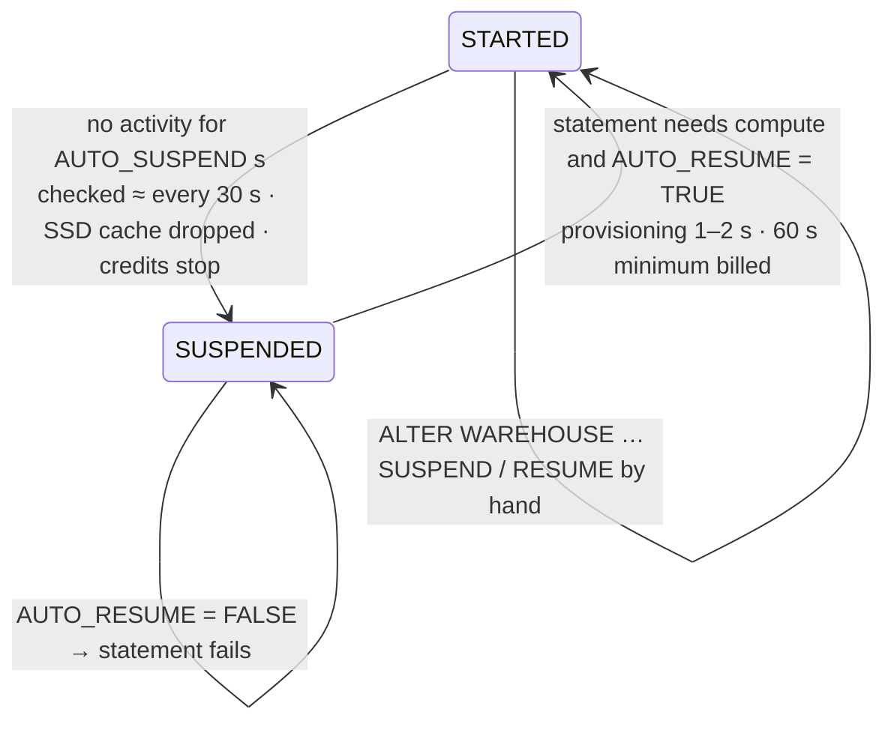

# Auto-suspend and Auto-resume

Two warehouse properties: suspend after N idle seconds (default 600) and start again on the next statement (default on); together they set the idle credits you pay and the SSD cache you keep.



## Numbers

| Thing | Value | Source |
|-------|-------|--------|
| `AUTO_SUSPEND` default | 600 s | create-warehouse |
| Disable | `0` or `NULL` (never suspends) | create-warehouse |
| Check interval | background process ≈ every 30 s; values < 30 or not multiples of 30 behave unpredictably | create-warehouse |
| `AUTO_RESUME` default | `TRUE`; `FALSE` → statements needing the warehouse fail until manual `RESUME` | create-warehouse |
| Minimum charge on resume | 60 s | [considerations](https://docs.snowflake.com/en/user-guide/warehouses-considerations) |
| Docs guidance | "a low value, e.g. 5 or 10 minutes or less"; 1–2 min with 2–3 min query gaps = repeated minimums | warehouses-considerations |
| Multi-cluster | suspends when all clusters are idle past the timeout; resumes with the minimum cluster count | [multi-cluster](https://docs.snowflake.com/en/user-guide/warehouses-multicluster) |

| Workload | Suggested `AUTO_SUSPEND` | Reason |
|----------|--------------------------|--------|
| ELT loads and transformations | 60–300 s | nothing worth caching between runs |
| Ad-hoc, data science | ≈ 300 s | pauses between queries |
| BI dashboards | ≥ 600 s | repeated scans of the same tables hit the SSD cache |

## How it works

- Last statement finishes → idle clock → next 30 s check past the timeout → `SUSPENDED` → nodes released, [[Warehouse Cache]] gone.
- Statement arrives → `AUTO_RESUME` → nodes provisioned → 60 s billed → `STARTED`.
- Resume gap: first query after resume waits for provisioning and runs cold.
- Idle time inside the timeout is billed: `CREDITS_USED_COMPUTE − CREDITS_ATTRIBUTED_COMPUTE_QUERIES`.

## Probe

```sql
ALTER WAREHOUSE WH_LEARN_XS SET AUTO_SUSPEND = 60, AUTO_RESUME = TRUE;
SELECT 42;                                        -- no warehouse needed; wait > 90 s
SHOW WAREHOUSES LIKE 'WH_LEARN_XS';               -- state SUSPENDED
SELECT COUNT(*) FROM SNOWFLAKE_SAMPLE_DATA.TPCH_SF1.LINEITEM WHERE L_QUANTITY > 10;
SHOW WAREHOUSES LIKE 'WH_LEARN_XS';               -- state STARTED, "resumed_on" updated
```

## Cost

Idle credits = `WAREHOUSE_METERING_HISTORY.CREDITS_USED_COMPUTE − CREDITS_ATTRIBUTED_COMPUTE_QUERIES` per hour per warehouse. Each resume = 60 s × size.

## Traps

- `0` means never suspend, not "suspend immediately".
- Suspend wipes the SSD cache; a shorter timeout makes repeated queries slower as well as cheaper.
- A query that "hangs" for a couple of seconds before starting is the warehouse resuming.

**vs Cloudera:** a cluster that idled at full cost all night → an idle timer per warehouse, and an explicit trade between cache warmth and minutes billed. See [[Hadoop to Snowflake Rosetta Stone]].

## Related

- [[Virtual Warehouse]]
- [[Warehouse Sizes and Credits]]
- [[Warehouse Cache]]
- [[Multi-cluster Warehouse]]
- [[Credits and Billing]]

## Explain it to a teammate (fill in yourself)

>
