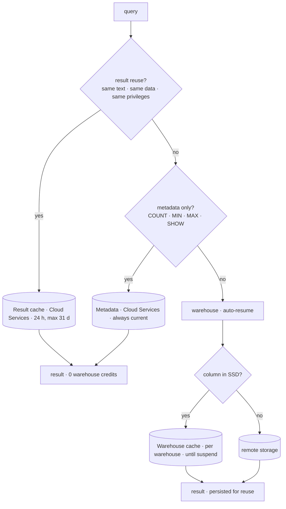

# Caching

Three caches in two layers: persisted results and metadata in Cloud Services, raw column data on each warehouse's SSD; a query is checked against them in that order.



## Numbers

| Cache | Lives in | Holds | Dropped by | Zero warehouse credits? |
|-------|----------|-------|------------|-------------------------|
| [[Result Cache]] | Cloud Services | full result of a query | 24 h idle, 31 d max, data change, reclustering | yes |
| [[Metadata Cache]] | Cloud Services | row count, min/max, distinct count per column per micro-partition | never stale; updated on every write | yes |
| [[Warehouse Cache]] | each warehouse's node SSD | raw columns of recently read micro-partitions | suspend; downsizing (removed nodes) | no, fewer seconds |

## How it works

- Order: result reuse → metadata shortcut → warehouse; the first two never start a warehouse.
- Result reuse keys on byte-identical SQL text; metadata serves only whole-table aggregates and object listings.
- Warehouse SSD is shared by all users of that warehouse and private to it; a second warehouse on the same table warms its own.
- `ALTER SESSION SET USE_CACHED_RESULT = FALSE` disables result reuse for benchmarking; nothing disables the SSD cache except suspend.

## Probe

```sql
ALTER SESSION SET USE_CACHED_RESULT = FALSE;
SELECT COUNT(*), SUM(L_QUANTITY) FROM SNOWFLAKE_SAMPLE_DATA.TPCH_SF1.LINEITEM
WHERE L_SHIPDATE BETWEEN '1995-01-01' AND '1995-01-31';   -- run twice
ALTER SESSION SET USE_CACHED_RESULT = TRUE;
```

Query Profile of run 2 → IO → `Percentage scanned from cache` > 0 (SSD). With reuse back on, a third run shows the `Query Result Reuse` node and no scan.

## Cost

Result and metadata hits → 0 warehouse credits (cloud services only, inside the 10 % allowance). SSD hits → fewer warehouse seconds. `QUERY_HISTORY.PERCENTAGE_SCANNED_FROM_CACHE` per query.

## Traps

- Three caches, two layers; only the SSD cache depends on the warehouse being up.
- A benchmark without `USE_CACHED_RESULT = FALSE` measures the result cache; a benchmark on a warm warehouse measures SSD.
- Result reuse is per account, not per user: another user with sufficient privileges gets the same persisted result.

**vs Cloudera:** OS page cache on DataNodes and Impala's own buffers, invisible and unmanaged → three named caches with documented scope and lifetime. See [[Hadoop to Snowflake Rosetta Stone]].

## Related

- [[Result Cache]]
- [[Warehouse Cache]]
- [[Metadata Cache]]
- [[Cloud Services Layer]]
- [[Virtual Warehouse]]

## Explain it to a teammate (fill in yourself)

>
