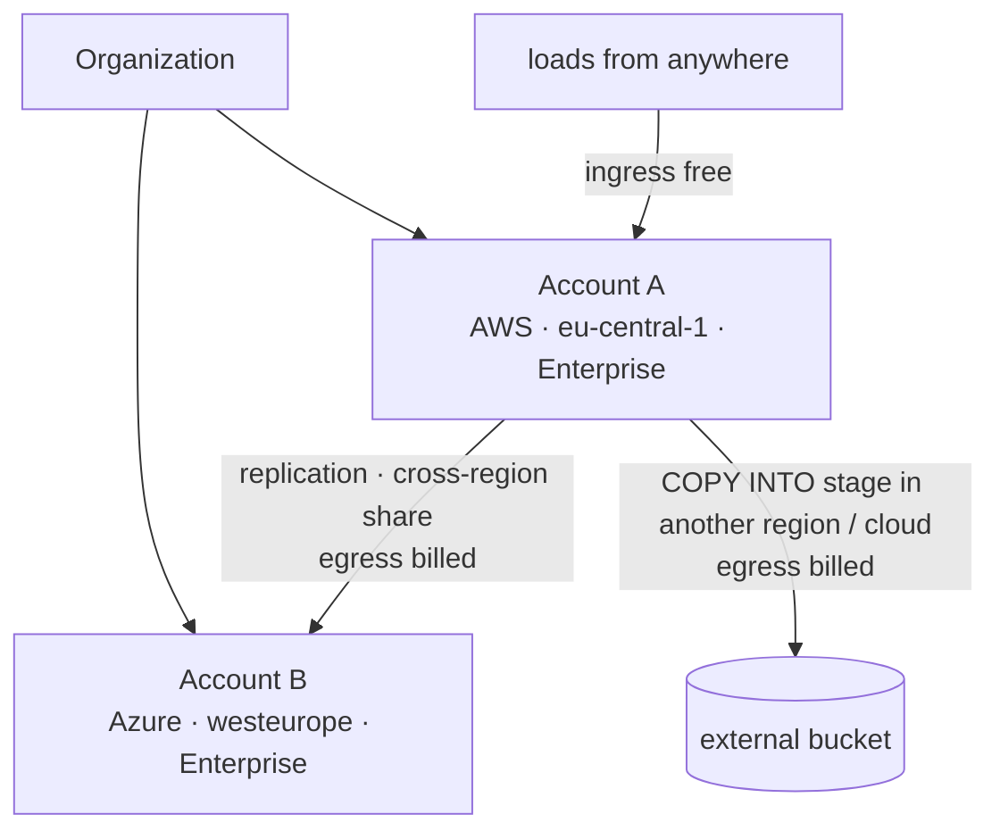

# Cloud Providers and Regions

One account lives in one region of one cloud (AWS, Azure or Google Cloud); storage and compute stay there, and every byte that leaves the region is metered as data transfer.



## Numbers

| Thing | Value | Source |
|-------|-------|--------|
| Providers | AWS, Microsoft Azure, Google Cloud; same SQL on all | intro-regions |
| Region | one per account, fixed at creation | intro-regions |
| Account identifier | `<orgname>-<account_name>` → `https://<orgname>-<account_name>.snowflakecomputing.com`; locator form (`xy12345.eu-central-1`) is legacy | [identifiers](https://docs.snowflake.com/en/user-guide/admin-account-identifier) |
| Largest sizes | 5X-Large and 6X-Large on AWS and Azure only | [warehouses-overview](https://docs.snowflake.com/en/user-guide/warehouses-overview) |
| Transfer | ingress free; egress to another region or cloud billed | [transfer cost](https://docs.snowflake.com/en/user-guide/cost-understanding-data-transfer) |
| Transfer view | `DATA_TRANSFER_HISTORY`: `BYTES_TRANSFERRED`, `SOURCE_REGION`, `TARGET_CLOUD`, `TARGET_REGION`, `TRANSFER_TYPE` (`COPY`, `REPLICATION`, `EXTERNAL_ACCESS`, …); latency ≤ 120 min | [view](https://docs.snowflake.com/en/sql-reference/account-usage/data_transfer_history) |

## How it works

- Account → region → object storage and warehouse nodes provisioned there; users log in from anywhere.
- Another region or cloud → another account ([[Organizations and Accounts]]), linked by replication or cross-region sharing, both moving bytes.
- Unloading to a bucket in the same region and cloud → no transfer charge; elsewhere → charged.
- Feeds to AEP, Pega and friends: put the account where the bulk of sources and consumers are, then measure `DATA_TRANSFER_HISTORY` after the first deliveries.

## Probe

```sql
SELECT CURRENT_REGION(), CURRENT_ORGANIZATION_NAME(), CURRENT_ACCOUNT_NAME();   -- e.g. AWS_EU_CENTRAL_1
SHOW REGIONS;
SELECT source_region, target_cloud, target_region, transfer_type, SUM(bytes_transferred) AS bytes
FROM SNOWFLAKE.ACCOUNT_USAGE.DATA_TRANSFER_HISTORY             -- ACCOUNTADMIN or SNOWFLAKE.USAGE_VIEWER
WHERE start_time >= DATEADD('day', -30, CURRENT_TIMESTAMP()) GROUP BY 1,2,3,4;
```

## Cost

Egress bytes × provider rate → `DATA_TRANSFER_HISTORY.BYTES_TRANSFERRED`; Snowsight → Admin » Cost management » Consumption → Usage type = Data transfer.

## Traps

- One account = one cloud + one region; "multi-region" means several accounts.
- Egress applies to unloads, replication, external access calls and cross-region shares, not to loading.
- Use the `<orgname>-<account_name>` identifier in every driver; the locator still works but is legacy.

**vs Cloudera:** one datacenter, free internal traffic → region choice is a cost decision for every outbound feed. See [[Hadoop to Snowflake Rosetta Stone]].

## Related

- [[Organizations and Accounts]]
- [[Credits and Billing]]
- [[What Snowflake Is]]
- [[Warehouse Sizes and Credits]]
- [[Database Storage Layer]]

## Explain it to a teammate (fill in yourself)

>
