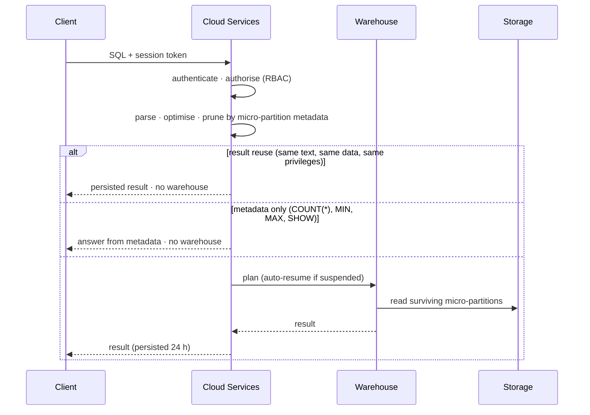

# Cloud Services Layer

The always-on coordination layer: authentication, access control, metadata, query parsing and optimisation, transactions, result reuse and infrastructure management; billed only above 10 % of the day's warehouse credits.



## Numbers

| Thing | Value | Source |
|-------|-------|--------|
| Billing rule | charged only for the part above 10 % of the day's warehouse credits, per day, UTC | [cloud services cost](https://docs.snowflake.com/en/user-guide/cost-understanding-compute) |
| Serverless credits | not part of the 10 % base | cost-understanding-compute |
| Where the adjustment shows | `METERING_DAILY_HISTORY.CREDITS_ADJUSTMENT_CLOUD_SERVICES` (≤ 0), `CREDITS_BILLED` | [metering view](https://docs.snowflake.com/en/sql-reference/account-usage/metering_daily_history) |
| Per-warehouse cloud services | `WAREHOUSE_METERING_HISTORY.CREDITS_USED_CLOUD_SERVICES`, latency ≤ 6 h | [view](https://docs.snowflake.com/en/sql-reference/account-usage/warehouse_metering_history) |
| Knobs | none: not sized, not suspended, not visible | intro-key-concepts |

## How it works

- Login → MFA/SSO → session → every statement authorised against roles and grants here.
- Parse → optimise → compare predicates with per-micro-partition min/max → plan names only surviving micro-partitions ([[Query Pruning]]).
- Before compute: [[Result Cache]] lookup, then [[Metadata Cache]] shortcut; either answers with zero warehouse credits.
- Otherwise plan → [[Virtual Warehouse]]; Cloud Services starts and stops the nodes.
- Transactions and the metadata store are here: `SHOW`, `DESCRIBE`, `INFORMATION_SCHEMA` never touch a warehouse.
- Daily: cloud services credits summed → 10 % of warehouse credits subtracted → remainder billed.

## Probe

```sql
ALTER WAREHOUSE WH_LEARN_XS SUSPEND;
SHOW TABLES IN SNOWFLAKE_SAMPLE_DATA.TPCH_SF1;                      -- runs
SELECT COUNT(*), MIN(L_SHIPDATE) FROM SNOWFLAKE_SAMPLE_DATA.TPCH_SF1.LINEITEM;  -- runs
SHOW WAREHOUSES LIKE 'WH_LEARN_XS';                                 -- still SUSPENDED
```

Snowsight → Query History → both queries list no warehouse time.

## Cost

Cloud services credits per statement → `WAREHOUSE_METERING_HISTORY.CREDITS_USED_CLOUD_SERVICES`; billed amount after the 10 % rule → `METERING_DAILY_HISTORY.CREDITS_BILLED`. Thousands of tiny metadata-heavy statements per day are what cross the line.

## Traps

- Not free: free up to 10 % of daily warehouse credits, excess billed.
- The optimizer is here; the warehouse only executes the plan it is handed.
- Any question offering a way to size or suspend Cloud Services describes something that does not exist.

**vs Cloudera:** Hive Metastore + Ranger + YARN ResourceManager + query compiler, run and patched by you → one managed layer that also holds per-micro-partition statistics and persisted results. See [[Hadoop to Snowflake Rosetta Stone]].

## Related

- [[Three-Layer Architecture]]
- [[Compute Layer]]
- [[Metadata Cache]]
- [[Result Cache]]
- [[Query Pruning]]
- [[Credits and Billing]]

## Explain it to a teammate (fill in yourself)

>
