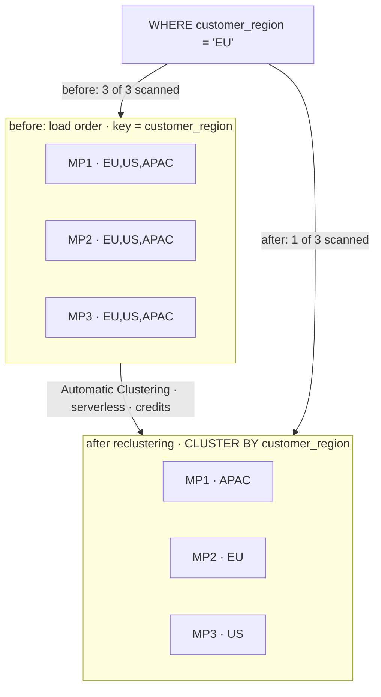

# Clustering Keys

A declared column list that Automatic Clustering uses to rewrite micro-partitions into narrow key ranges, so pruning works on a column that load order does not sort.



## Numbers

| Thing | Value | Source |
|-------|-------|--------|
| When | multi-terabyte tables with selective filters or joins on a non-pruning column | clustering-keys page |
| Key width | 3 to 4 columns at most, lowest cardinality first | clustering-keys page |
| Cardinality | moderate: date yes, timestamp no (cluster on `TO_DATE(ts)`), UUID no | clustering-keys page |
| Measure | `SYSTEM$CLUSTERING_DEPTH` and `SYSTEM$CLUSTERING_INFORMATION` (`average_depth`, `average_overlaps`); lower is better | [function](https://docs.snowflake.com/en/sql-reference/functions/system_clustering_information) |
| Compute | serverless; `METERING_DAILY_HISTORY.SERVICE_TYPE = 'AUTO_CLUSTERING'`; per table in `AUTOMATIC_CLUSTERING_HISTORY` (`CREDITS_USED`, `NUM_BYTES_RECLUSTERED`), latency ≤ 180 min | [view](https://docs.snowflake.com/en/sql-reference/account-usage/automatic_clustering_history) |
| Exceptions | clones start with Automatic Clustering suspended; not available on hybrid tables | clustering-keys page |

## How it works

- `ALTER TABLE t CLUSTER BY (k1, k2)` → key stored; nothing rewritten yet.
- Automatic Clustering → watches new or changed [[Micro-partitions]] → reclusters in the background on Snowflake compute → old micro-partitions retained for Time Travel.
- Reclustered table → disjoint key ranges → [[Query Pruning]] on `k1`, `k2`.
- Every subsequent load disturbs the order → more reclustering → recurring credits.
- `ALTER TABLE t SUSPEND RECLUSTER` / `RESUME RECLUSTER` controls the service.

## Probe

```sql
SELECT SYSTEM$CLUSTERING_DEPTH('SNOWFLAKE_SAMPLE_DATA.TPCH_SF1.LINEITEM', '(L_SHIPDATE)');
SELECT SYSTEM$CLUSTERING_DEPTH('SNOWFLAKE_SAMPLE_DATA.TPCH_SF1.LINEITEM', '(L_COMMENT)');
-- on your own table:  ALTER TABLE fct_orders CLUSTER BY (order_date, customer_region);
```

Depth near 1 on `L_SHIPDATE` (naturally ordered), far higher on `L_COMMENT`.

## Cost

Serverless credits → `AUTOMATIC_CLUSTERING_HISTORY.CREDITS_USED`; storage for retained versions → `TABLE_STORAGE_METRICS.TIME_TRAVEL_BYTES`. No warehouse of yours runs.

## Traps

- Clustering a small table or a frequently rewritten one burns credits for no pruning gain.
- It bills with no warehouse running; watch `AUTO_CLUSTERING` in the daily metering.
- A cloned table needs `RESUME RECLUSTER`.


## Related

- [[Micro-partitions]]
- [[Query Pruning]]
- [[Database Storage Layer]]
- [[Credits and Billing]]

## Explain it to a teammate (fill in yourself)

>
