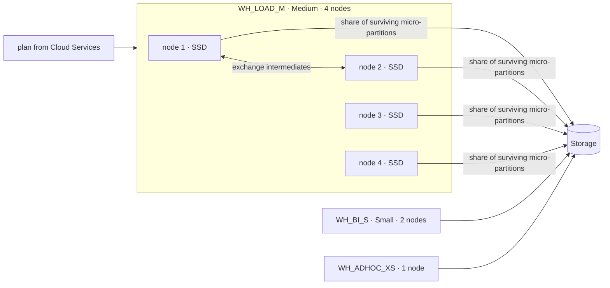

# Compute Layer

The query processing layer: independent MPP clusters (virtual warehouses) that execute plans from Cloud Services against shared storage and are the only layer you size and pay for by the second.



## Numbers

| Thing | Value | Source |
|-------|-------|--------|
| Nodes per size | double each step: XS 1 … 4XL 128 (credits/hour track the same table) | [warehouses-overview](https://docs.snowflake.com/en/user-guide/warehouses-overview) |
| Billing | per second, 60 s minimum per start | warehouses-overview |
| Isolation | warehouses never share nodes | intro-key-concepts |
| Local cache | SSD per node, dropped on suspend | [considerations](https://docs.snowflake.com/en/user-guide/warehouses-considerations) |
| Spill | `Bytes spilled to local storage`, then `… to remote storage` in Query Profile | [Query Profile](https://docs.snowflake.com/en/user-guide/ui-snowsight-activity) |

## How it works

- Plan → nodes each take a slice of the surviving [[Micro-partitions]] → scan only referenced columns → exchange for joins and aggregates → result back to Cloud Services.
- Memory exhausted → spill to node SSD → SSD exhausted → spill to remote storage (slow): the signal to [[Scaling Up vs Scaling Out|scale up]].
- Queue forms when concurrent statements exceed the cluster's slots → the signal to scale out ([[Multi-cluster Warehouse]]).
- SSD holds recently read columns across queries while the warehouse runs ([[Warehouse Cache]]).
- One warehouse per workload (load, transform, BI, ad-hoc) → no contention between them; naming `WH_<TEAM>_<PURPOSE>_<SIZE>` (Day 3).

## Probe

```sql
SELECT query_id, warehouse_name, execution_time, queued_overload_time
FROM TABLE(INFORMATION_SCHEMA.QUERY_HISTORY(RESULT_LIMIT => 20))
ORDER BY start_time DESC;
```

Snowsight → Query Profile of a heavy query → Spilling section: `Bytes spilled to local storage` / `… remote storage`; IO section: `Percentage scanned from cache`.

## Cost

Credits per second × size × running clusters → `WAREHOUSE_METERING_HISTORY.CREDITS_USED_COMPUTE`; per query → `QUERY_ATTRIBUTION_HISTORY.CREDITS_ATTRIBUTED_COMPUTE`. See [[Warehouse Sizes and Credits]].

## Traps

- "Query Processing layer" = "Compute layer"; the docs use both.
- A warehouse holds no tables; dropping one loses nothing.
- Remote spill is the expensive symptom; fix it by sizing up, not by adding clusters.

**vs Cloudera:** Spark executors and Impala daemons sharing one YARN cluster → separate clusters per workload, created in seconds, with no HDFS locality to plan around. See [[Hadoop to Snowflake Rosetta Stone]].

## Related

- [[Three-Layer Architecture]]
- [[Virtual Warehouse]]
- [[Warehouse Sizes and Credits]]
- [[Scaling Up vs Scaling Out]]
- [[Warehouse Cache]]

## Explain it to a teammate (fill in yourself)

>
