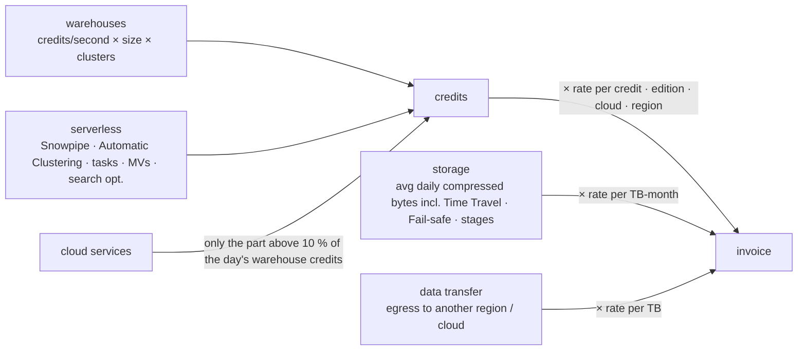

# Credits and Billing

Three meters: compute in credits (warehouses, serverless, cloud services above 10 %), storage in TB-month of compressed bytes, and data transfer in egress bytes.



## Numbers

| Meter | Unit | Rule | Where it shows |
|-------|------|------|----------------|
| Warehouses | credit | per second, 60 s minimum per start | `WAREHOUSE_METERING_HISTORY.CREDITS_USED_COMPUTE` |
| Serverless | credit | Snowflake-managed compute, no warehouse of yours | `METERING_DAILY_HISTORY.SERVICE_TYPE` (`PIPE`, `AUTO_CLUSTERING`, `SERVERLESS_TASK`, `MATERIALIZED_VIEW`, `SEARCH_OPTIMIZATION`, …) |
| Cloud services | credit | billed only above 10 % of that day's warehouse credits (UTC); serverless excluded from the base | `METERING_DAILY_HISTORY.CREDITS_ADJUSTMENT_CLOUD_SERVICES` (≤ 0), `CREDITS_BILLED` |
| Storage | TB-month | average daily compressed bytes, incl. Time Travel, Fail-safe, internal stages | `STORAGE_USAGE` (`STORAGE_BYTES`, `STAGE_BYTES`, `FAILSAFE_BYTES`) |
| Transfer | TB | ingress free; egress out of the region or cloud | `DATA_TRANSFER_HISTORY.BYTES_TRANSFERRED` |

Sources: cost-understanding-overall and the linked view pages. Currency: `ORGANIZATION_USAGE.USAGE_IN_CURRENCY_DAILY`, rates in `RATE_SHEET_DAILY`.

## How it works

- Warehouse seconds → hourly credits per warehouse → daily totals per service type.
- Cloud services credits per day → minus 10 % of warehouse credits → remainder billed; most days the adjustment cancels them.
- Storage sampled daily → averaged over the month → one TB-month figure.
- Credits × rate sheet + storage × rate + transfer × rate → invoice at organization level.
- Guardrails: resource monitors (per warehouse or account credit caps) and budgets (Day 2).

## Probe

```sql
SELECT usage_date, service_type, credits_used, credits_adjustment_cloud_services, credits_billed
FROM SNOWFLAKE.ACCOUNT_USAGE.METERING_DAILY_HISTORY            -- ACCOUNTADMIN or SNOWFLAKE.USAGE_VIEWER
WHERE usage_date >= DATEADD('day', -7, CURRENT_DATE()) ORDER BY 1 DESC, 5 DESC;
```

Snowsight → Admin » Cost management » Consumption → Usage type = Compute / Storage / Data transfer. The full read of metrics and price, with the queries to run, is the last stop of [[Day 3]].

## Cost

This note is the map. The only number that is money is `CREDITS_BILLED` × the rate sheet.

## Traps

- Three meters; compute has three parts (warehouses, serverless, cloud services).
- Snowsight and most views show cloud-services credits before the 10 % adjustment.
- Storage bills compressed bytes plus retained history, so a daily full rewrite with long Time Travel multiplies the bill.

**vs Cloudera:** capex plus node-hours regardless of load → three metered lines you can read per hour, per table and per transfer. See [[Hadoop to Snowflake Rosetta Stone]].

## Related

- [[Warehouse Sizes and Credits]]
- [[Cloud Services Layer]]
- [[Database Storage Layer]]
- [[Cloud Providers and Regions]]
- [[Snowsight]]

## Explain it to a teammate (fill in yourself)

>
