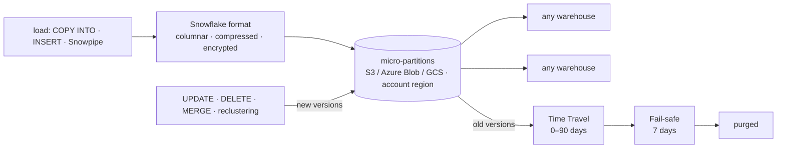

# Database Storage Layer

Managed object storage in the account's region holding every table as compressed, encrypted, columnar micro-partitions, billed per TB-month of average daily compressed bytes including retained history.



## Numbers

| Thing | Value | Source |
|-------|-------|--------|
| Unit | micro-partition, 50–500 MB uncompressed | [micro-partitions](https://docs.snowflake.com/en/user-guide/tables-clustering-micropartitions) |
| Time Travel | default 1 day; max 1 (Standard) / 90 (Enterprise+) | [editions](https://docs.snowflake.com/en/user-guide/intro-editions) |
| Fail-safe | 7 days after Time Travel, all editions, Snowflake-only recovery | intro-editions |
| Billing basis | average daily compressed bytes, incl. Time Travel, Fail-safe, internal stages | [storage cost](https://docs.snowflake.com/en/user-guide/cost-understanding-data-storage) |
| Account view | `STORAGE_USAGE`: `STORAGE_BYTES`, `STAGE_BYTES`, `FAILSAFE_BYTES`, daily, latency ≤ 120 min | [view](https://docs.snowflake.com/en/sql-reference/account-usage/storage_usage) |
| Per table | `TABLE_STORAGE_METRICS`: `ACTIVE_BYTES`, `TIME_TRAVEL_BYTES`, `FAILSAFE_BYTES`, `RETAINED_FOR_CLONE_BYTES` | [view](https://docs.snowflake.com/en/sql-reference/account-usage/table_storage_metrics) |

## How it works

- Load → rows rewritten into Snowflake's format → [[Micro-partitions]] → object storage; the bucket is Snowflake's, not yours.
- Every [[Virtual Warehouse]] reads the same bytes; nothing is copied per cluster.
- Writes never modify a micro-partition; new versions are written and old ones move through Time Travel → Fail-safe → purge (Day 2).
- Clone = new table pointing at the same micro-partitions; bytes are billed once until either side diverges (Day 2).
- Exit paths: SQL result sets, `COPY INTO <stage>`, secure data sharing. No file-level access.

## Probe

```sql
SELECT table_name, active_bytes, time_travel_bytes, failsafe_bytes
FROM SNOWFLAKE.ACCOUNT_USAGE.TABLE_STORAGE_METRICS            -- ACCOUNTADMIN or SNOWFLAKE.USAGE_VIEWER
WHERE table_catalog = CURRENT_DATABASE()
ORDER BY active_bytes DESC LIMIT 20;
SHOW TABLES IN SNOWFLAKE_SAMPLE_DATA.TPCH_SF1;   -- "bytes" column = compressed size, no warehouse
```

Snowsight → Admin » Cost management » Consumption → Usage type = Storage.

## Cost

TB-month of `STORAGE_USAGE.STORAGE_BYTES + STAGE_BYTES + FAILSAFE_BYTES`, averaged per day. Rewrite-heavy tables cost active + retained versions.

## Traps

- No path to the files: not via the bucket, not via a connector.
- Billed compressed; columnar compression typically shrinks CSV several times.
- A table rewritten daily with 90-day Time Travel stores up to 90 versions.

**vs Cloudera:** HDFS directories and Parquet files you laid out, replicated 3× on your disks → format, layout and durability owned by Snowflake; data leaves only through SQL, unload or share. See [[Hadoop to Snowflake Rosetta Stone]].

## Related

- [[Three-Layer Architecture]]
- [[Micro-partitions]]
- [[Query Pruning]]
- [[Credits and Billing]]
- [[Compute Layer]]

## Explain it to a teammate (fill in yourself)

>
