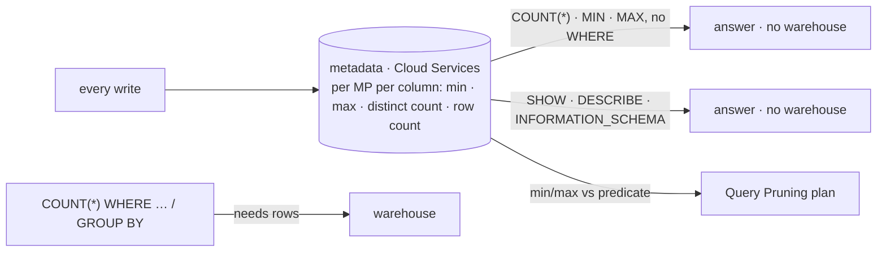

# Metadata Cache

Per-micro-partition statistics maintained in Cloud Services on every write, serving whole-table aggregates, object listings and pruning without a warehouse.



## Numbers

| Thing | Value | Source |
|-------|-------|--------|
| Kept per micro-partition | value range per column, number of distinct values, other properties | micropartitions page |
| Freshness | updated as part of every write; no `ANALYZE` | micropartitions page |
| Served without a warehouse | whole-table `COUNT(*)`, `MIN`, `MAX` for most data types; `SHOW`, `DESCRIBE` | intro-key-concepts |
| Falls back to a warehouse | any `WHERE`, `GROUP BY`, `DISTINCT`, join | behaviour, see probe |
| Name | training and exam term; the docs say "metadata" | — |

## How it works

- Write → micro-partition registered with its statistics → nothing to refresh later.
- `SELECT COUNT(*) FROM t` → sum of row counts from metadata → returned by [[Cloud Services Layer]].
- `MIN(col)` / `MAX(col)` → min of mins, max of maxes.
- Predicate → compared with the same min/max → [[Query Pruning]] decided before compute.
- Add a filter → rows must be read → [[Virtual Warehouse]] resumes.

## Probe

```sql
ALTER WAREHOUSE WH_LEARN_XS SUSPEND;
SELECT COUNT(*), MIN(L_SHIPDATE), MAX(L_SHIPDATE) FROM SNOWFLAKE_SAMPLE_DATA.TPCH_SF1.LINEITEM;
SHOW WAREHOUSES LIKE 'WH_LEARN_XS';                                   -- still SUSPENDED
SELECT COUNT(*) FROM SNOWFLAKE_SAMPLE_DATA.TPCH_SF1.LINEITEM WHERE L_QUANTITY > 10;
SHOW WAREHOUSES LIKE 'WH_LEARN_XS';                                   -- STARTED
```

Query History: the first query shows no warehouse; the second shows `WH_LEARN_XS`.

## Cost

0 warehouse credits for metadata answers; cloud services credits only, inside the 10 % allowance ([[Credits and Billing]]).

## Traps

- One `WHERE` turns a free query into a warehouse query.
- Statistics are never stale; there is nothing to recompute.
- Lives in Cloud Services beside the [[Result Cache]], not on the warehouse.

**vs Cloudera:** Hive statistics via `ANALYZE TABLE … COMPUTE STATISTICS`, stale the moment data landed → maintained on every write, exact, and usable for answers not just plans. See [[Hadoop to Snowflake Rosetta Stone]].

## Related

- [[Caching]]
- [[Micro-partitions]]
- [[Query Pruning]]
- [[Cloud Services Layer]]
- [[Result Cache]]

## Explain it to a teammate (fill in yourself)

>
