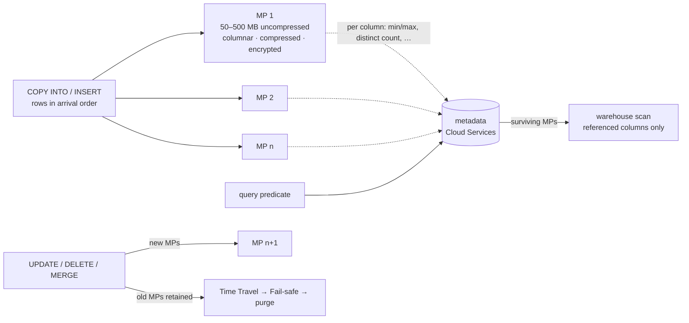

# Micro-partitions

The unit of storage: a columnar block of 50 to 500 MB of uncompressed rows, written in load order, described by per-column metadata that the optimizer prunes on.



## Numbers

| Thing | Value | Source |
|-------|-------|--------|
| Size | 50–500 MB uncompressed; smaller on disk | micropartitions page |
| Metadata per micro-partition | value range per column, number of distinct values, other optimisation properties | micropartitions page |
| Creation | automatic, in load order; no DDL | micropartitions page |
| DML | writes new micro-partitions; old ones kept for the retention period | [Time Travel](https://docs.snowflake.com/en/user-guide/data-time-travel) |
| `SYSTEM$CLUSTERING_INFORMATION` output | `total_partition_count`, `average_overlaps`, `average_depth`, `partition_depth_histogram` | [function page](https://docs.snowflake.com/en/sql-reference/functions/system_clustering_information) |
| Storage per table | `ACTIVE_BYTES`, `TIME_TRAVEL_BYTES`, `FAILSAFE_BYTES`, `RETAINED_FOR_CLONE_BYTES` | [TABLE_STORAGE_METRICS](https://docs.snowflake.com/en/sql-reference/account-usage/table_storage_metrics), latency ≤ 90 min |

## How it works

- Load → rows cut into micro-partitions by arrival order → columnar encode, compress, encrypt → object storage ([[Database Storage Layer]]).
- Each micro-partition → metadata row in [[Cloud Services Layer]]: min/max and distinct count per column, row count.
- Query → predicate vs min/max → only overlapping micro-partitions are read ([[Query Pruning]]) → only referenced columns inside them.
- Date-like columns loaded in time order → narrow ranges per micro-partition → prune well. Scattered columns → every micro-partition overlaps → no pruning → [[Clustering Keys]] on multi-TB tables.
- `UPDATE` / `DELETE` / `MERGE` → affected micro-partitions rewritten whole → old versions retained → billed until purged.
- Metadata answers `COUNT(*)`, `MIN`, `MAX` without a warehouse ([[Metadata Cache]]).

## Probe

```sql
SELECT SYSTEM$CLUSTERING_INFORMATION('SNOWFLAKE_SAMPLE_DATA.TPCH_SF1.LINEITEM', '(L_SHIPDATE)');
-- JSON: total_partition_count, average_overlaps, average_depth, partition_depth_histogram
SELECT COUNT(*), SUM(L_QUANTITY)
FROM SNOWFLAKE_SAMPLE_DATA.TPCH_SF1.LINEITEM
WHERE L_SHIPDATE BETWEEN '1995-01-01' AND '1995-01-31';
```

Snowsight → Query History → the query → Query Profile → TableScan: `Partitions scanned` ≪ `Partitions total`.

## Cost

Storage = compressed bytes of all retained micro-partitions, averaged daily → `ACCOUNT_USAGE.TABLE_STORAGE_METRICS` (`ACTIVE_BYTES` + `TIME_TRAVEL_BYTES` + `FAILSAFE_BYTES`). Pruned micro-partitions cost no compute.

## Traps

- The 50–500 MB figure is uncompressed; on-disk size is smaller.
- No `PARTITION BY` on standard tables; partitioning is automatic.
- Frequent row updates rewrite whole micro-partitions and keep the old ones; storage grows beyond the table's live size.

**vs Cloudera:** Hive partition directories you named and repaired → automatic, invisible blocks with per-column statistics; no `MSCK REPAIR`, no small-files problem to manage. See [[Hadoop to Snowflake Rosetta Stone]].

## Related

- [[Database Storage Layer]]
- [[Query Pruning]]
- [[Clustering Keys]]
- [[Metadata Cache]]
- [[Cloud Services Layer]]

## Explain it to a teammate (fill in yourself)

>
