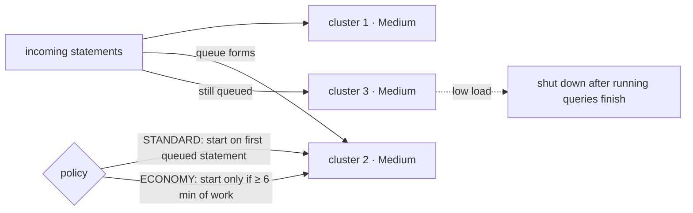

# Multi-cluster Warehouse

An Enterprise-edition warehouse that runs 1 to N identical clusters, adding one when statements queue and removing it when load drops, under a Standard or Economy policy.



## Numbers

| Thing | Value | Source |
|-------|-------|--------|
| Edition | Enterprise or higher; Standard cannot set `MAX_CLUSTER_COUNT > 1` | multi-cluster page |
| Modes | Maximized: `MIN = MAX > 1`, all clusters always on; Auto-scale: `MIN < MAX` | multi-cluster page |
| Max clusters, Snowsight | 10 | multi-cluster page |
| Max clusters, SQL by size | XS–M 300 · L 160 · XL 80 · 2XL 40 · 3XL 20 · 4XL–6XL 10 | multi-cluster page |
| `SCALING_POLICY = STANDARD` (default) | starts a cluster when a statement queues or is estimated to; shuts the least-loaded down after a sustained period of low load | multi-cluster page |
| `SCALING_POLICY = ECONOMY` | starts only if the estimated load keeps a cluster busy ≥ 6 min; marks a cluster for shutdown when < 6 min of work remain | multi-cluster page |
| Credits | size credits × started clusters, per second | multi-cluster page |

## How it works

- `CREATE WAREHOUSE … MIN_CLUSTER_COUNT = 1 MAX_CLUSTER_COUNT = 4 SCALING_POLICY = STANDARD`.
- Statements exceed cluster 1's slots → queue → policy decides → cluster 2 starts (60 s minimum each) → queue drains.
- Load falls → least-loaded cluster finishes its statements → shuts down → back to `MIN`.
- Each cluster has its own SSD cache ([[Warehouse Cache]]); a new cluster starts cold.
- Auto-suspend applies when every cluster is idle; resume brings back `MIN` clusters ([[Auto-suspend and Auto-resume]]).

## Probe

```sql
SHOW WAREHOUSES;     -- "min_cluster_count", "max_cluster_count", "started_clusters", "scaling_policy"
ALTER WAREHOUSE WH_BI_M SET MAX_CLUSTER_COUNT = 3, SCALING_POLICY = ECONOMY;   -- Enterprise only
SELECT start_time, avg_running, avg_queued_load
FROM SNOWFLAKE.ACCOUNT_USAGE.WAREHOUSE_LOAD_HISTORY                     -- ACCOUNTADMIN or SNOWFLAKE.USAGE_VIEWER
WHERE warehouse_name = 'WH_BI_M' ORDER BY start_time DESC LIMIT 24;   -- 5-min grain
```

Snowsight → Admin » Warehouses → cluster count and queued statements per warehouse.

## Cost

`WAREHOUSE_METERING_HISTORY.CREDITS_USED_COMPUTE` already sums all clusters; a Medium at 4 clusters bills up to 16 Gen1 credits/hour. Economy trades queue time for fewer cluster starts.

## Traps

- Standard edition: `MAX_CLUSTER_COUNT` stays 1; the parameters exist but cannot exceed it.
- `MIN = MAX` is maximized mode and bills every cluster whenever the warehouse is started.
- UI caps at 10 clusters; SQL allows up to 300 for small sizes.


## Related

- [[Scaling Up vs Scaling Out]]
- [[Virtual Warehouse]]
- [[Warehouse Sizes and Credits]]
- [[Snowflake Editions]]
- [[Auto-suspend and Auto-resume]]

## Explain it to a teammate (fill in yourself)

>
