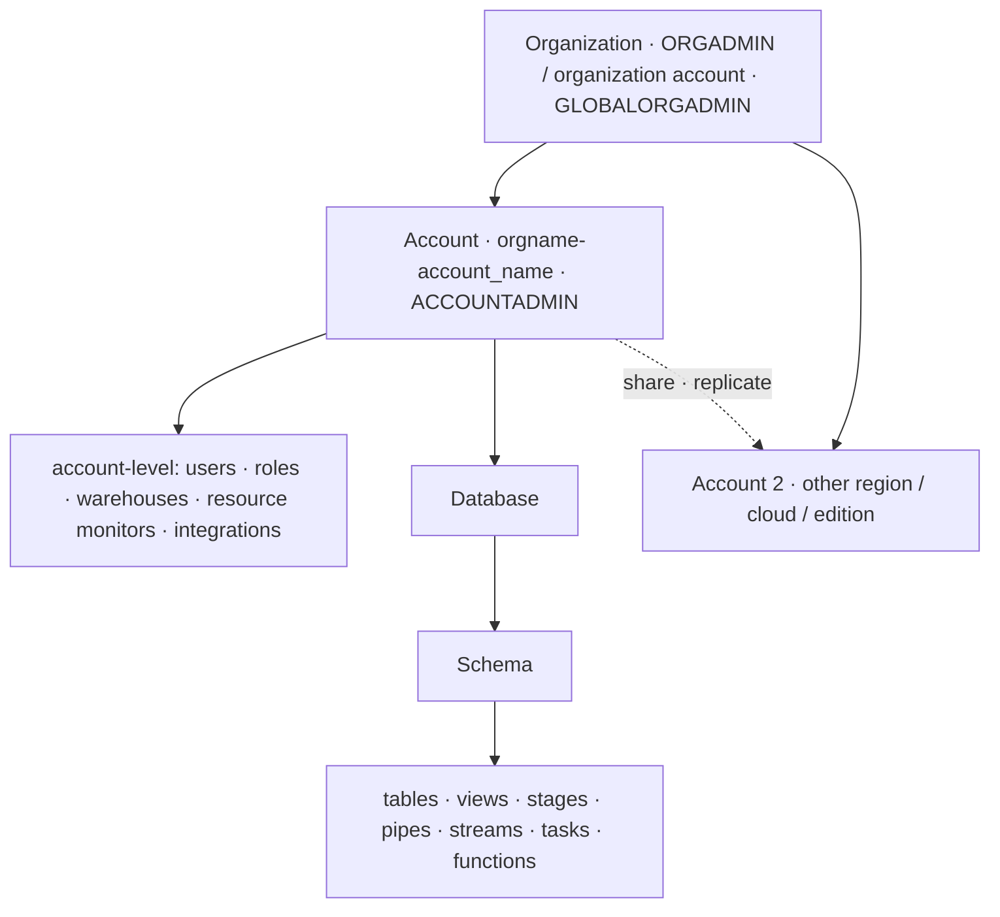

# Organizations and Accounts

An organization groups accounts for billing and cross-account features; an account is the login boundary that owns one cloud, one region, one edition and its own users, roles, warehouses and databases.



## Numbers

| Thing | Value | Source |
|-------|-------|--------|
| Organization role | `ORGADMIN`: create and list accounts, enable replication | organizations page |
| Multi-account admin | organization account with `GLOBALORGADMIN` | organizations page |
| Account top role | `ACCOUNTADMIN` (not the same as `ORGADMIN`) | organizations page |
| Identifier | `<orgname>-<account_name>`; names unique within the org, no hyphens | [identifiers](https://docs.snowflake.com/en/user-guide/admin-account-identifier) |
| Hierarchy | account → database → schema → objects | [intro-key-concepts](https://docs.snowflake.com/en/user-guide/intro-key-concepts) |
| Visibility across accounts | none without sharing or replication | organizations page |
| Org-wide usage | `SNOWFLAKE.ORGANIZATION_USAGE` (`ACCOUNTS`, `USAGE_IN_CURRENCY_DAILY`, `RATE_SHEET_DAILY`) | [org usage](https://docs.snowflake.com/en/sql-reference/organization-usage) |

## How it works

- `ORGADMIN` → `CREATE ACCOUNT` → new region, cloud or edition under the same bill.
- Account-level objects (users, roles, warehouses, resource monitors, integrations) → one set per account; databases nest schemas nest objects (Day 2).
- Environments: separate accounts (hard isolation, separate billing lines) or separate databases in one account (`ANALYTICS_DEV`, `ANALYTICS_PROD`; cheaper, cloneable). Day 3's standard uses databases.
- Billing rolls up to the organization → `ORGANIZATION_USAGE` is where currency figures live (phase 1 capstone).

## Probe

```sql
SELECT CURRENT_ORGANIZATION_NAME(), CURRENT_ACCOUNT_NAME(), CURRENT_REGION();
SHOW ORGANIZATION ACCOUNTS;                                    -- ORGADMIN
SELECT account_name, snowflake_region, edition FROM SNOWFLAKE.ORGANIZATION_USAGE.ACCOUNTS;  -- org usage access
```

Snowsight → Admin » Accounts (ORGADMIN) lists every account with region and edition.

## Cost

No direct cost; the organization is the billing unit → `ORGANIZATION_USAGE.USAGE_IN_CURRENCY_DAILY` per account per day.

## Traps

- `ORGADMIN` ≠ `ACCOUNTADMIN`: organization scope vs one account.
- Warehouses and roles are account-level; they do not live inside a database.
- Account names cannot contain hyphens; the identifier joins org and account with one.


## Related

- [[Cloud Providers and Regions]]
- [[Snowflake Editions]]
- [[Credits and Billing]]
- [[Snowflake Account]]
- [[What Snowflake Is]]

## Explain it to a teammate (fill in yourself)

>
