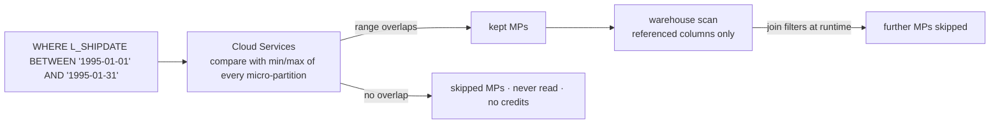

# Query Pruning

Skipping micro-partitions whose per-column min/max cannot satisfy the predicate, decided from metadata in Cloud Services before the warehouse reads anything.



## Numbers

| Thing | Value | Source |
|-------|-------|--------|
| Decided where | Cloud Services at compile time, from metadata; extra runtime pruning on the warehouse (e.g. join filters) | micropartitions page |
| Evidence | Query Profile → TableScan → `Partitions scanned` vs `Partitions total` | [Query Profile](https://docs.snowflake.com/en/user-guide/ui-snowsight-activity) |
| Same numbers in SQL | `ACCOUNT_USAGE.QUERY_HISTORY.PARTITIONS_SCANNED`, `PARTITIONS_TOTAL` (latency ≤ 45 min) | [view](https://docs.snowflake.com/en/sql-reference/account-usage/query_history) |
| Prunes | `=`, `<`, `>`, `BETWEEN`, `IN` on a bare column | micropartitions page |
| Defeats pruning | function wrapped around the column, `LIKE '%x'`, type coercion, scattered column values | micropartitions page |

## How it works

- Predicate → per-column range per [[Micro-partitions|micro-partition]] → keep only overlapping ranges → plan lists them.
- Kept micro-partitions → warehouse reads only the referenced columns (columnar).
- Natural order helps: time-ordered loads give disjoint date ranges; a UUID column overlaps everywhere → nothing skipped.
- Function on the column (`TO_CHAR(L_SHIPDATE,'YYYY-MM')`) → optimizer cannot compare to min/max → full scan.
- Multi-TB table filtered on a non-pruning column → [[Clustering Keys]].

## Probe

```sql
SELECT COUNT(*), SUM(L_QUANTITY) FROM SNOWFLAKE_SAMPLE_DATA.TPCH_SF1.LINEITEM
WHERE L_SHIPDATE BETWEEN '1995-01-01' AND '1995-01-31';            -- prunes
SELECT COUNT(*), SUM(L_QUANTITY) FROM SNOWFLAKE_SAMPLE_DATA.TPCH_SF1.LINEITEM
WHERE TO_CHAR(L_SHIPDATE, 'YYYY-MM') = '1995-01';                   -- does not
```

Snowsight → Query Profile of each → `Partitions scanned` / `Partitions total`: small ratio, then ≈ 1.

## Cost

Skipped micro-partitions cost nothing; scanned ones cost warehouse seconds → `CREDITS_ATTRIBUTED_COMPUTE` per query. The ratio in `QUERY_HISTORY` is the cheapest performance review you have.

## Traps

- Pruning is metadata work in Cloud Services; the warehouse never sees skipped micro-partitions.
- Any function around the filtered column, or a `LIKE` with a leading wildcard, turns the filter into a full scan.
- `Partitions scanned` ≪ `Partitions total` is the proof; a low number alone proves nothing.


## Related

- [[Micro-partitions]]
- [[Clustering Keys]]
- [[Cloud Services Layer]]
- [[Metadata Cache]]
- [[Snowsight]]

## Explain it to a teammate (fill in yourself)

>
