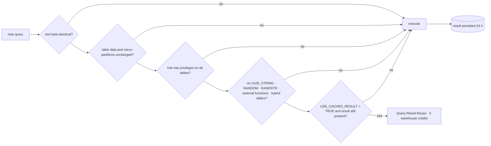

# Result Cache

Persisted query results in Cloud Services, returned without a warehouse when a new query matches an earlier one exactly and nothing underneath has changed.



## Numbers

| Thing | Value | Source |
|-------|-------|--------|
| Lifetime | 24 h after last use; each reuse resets it; purged 31 days after first execution | persisted-results page |
| Match | exact text: case, whitespace, aliases all matter | persisted-results page |
| Blockers | `UUID_STRING`, `RANDOM`, `RANDSTR`, external functions, hybrid tables, changed session options that affect results | persisted-results page |
| Data | no DML since, and micro-partitions unchanged (reclustering counts) | persisted-results page |
| Switch | `USE_CACHED_RESULT` session/user/account parameter, default `TRUE` | persisted-results page |
| Large results | > 100 KB served via a token valid 6 h | persisted-results page |

## How it works

- Every successful query → result persisted in Cloud Services.
- Next query → the checks above → hit → served from storage of the result, no warehouse, Query Profile shows a single `Query Result Reuse` node.
- Any write to a referenced table, or Automatic Clustering rewriting its [[Micro-partitions]], invalidates.
- `SHOW` results reuse only for the same role that produced them.
- Meeting every condition is necessary, not a guarantee.

## Probe

```sql
SELECT COUNT(*), SUM(L_QUANTITY) FROM SNOWFLAKE_SAMPLE_DATA.TPCH_SF1.LINEITEM
WHERE L_SHIPDATE BETWEEN '1995-01-01' AND '1995-01-31';   -- run twice, identical text
SELECT query_id, total_elapsed_time, warehouse_name
FROM TABLE(INFORMATION_SCHEMA.QUERY_HISTORY(RESULT_LIMIT => 5)) ORDER BY start_time DESC;
```

Run 2: milliseconds, Query Profile = `Query Result Reuse`. Change one character (`select` lowercase) → full execution again.

## Cost

0 warehouse credits on a hit; the lookup is cloud services work inside the 10 % allowance. `QUERY_HISTORY.BYTES_SCANNED = 0` on reused queries.

## Traps

- `SELECT *` and `select *` are different queries to this cache.
- Reclustering is a data change even though no row changed.
- Per account: a different user whose role can read the tables gets the persisted result.

**vs Cloudera:** nothing equivalent in Hive or Impala; result caching lived in the BI tool. See [[Hadoop to Snowflake Rosetta Stone]].

## Related

- [[Caching]]
- [[Cloud Services Layer]]
- [[Warehouse Cache]]
- [[Metadata Cache]]
- [[Snowsight]]

## Explain it to a teammate (fill in yourself)

>
