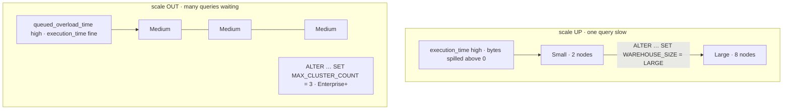

# Scaling Up vs Scaling Out

Up = a bigger size for one slow query; out = more clusters of the same size for many queued queries. The symptom in Query History decides which.



## Numbers

| Thing | Value | Source |
|-------|-------|--------|
| Resize effect | immediate for new and queued statements; running ones finish on the old nodes | warehouses-considerations |
| Downsize | drops the removed nodes' SSD cache | warehouses-considerations |
| Scale out | `MAX_CLUSTER_COUNT > 1`, Enterprise edition or higher | [multi-cluster](https://docs.snowflake.com/en/user-guide/warehouses-multicluster) |
| Up symptom | `EXECUTION_TIME` dominates; `Bytes spilled to local/remote storage` in Query Profile | [Query Profile](https://docs.snowflake.com/en/user-guide/ui-snowsight-activity) |
| Out symptom | `QUEUED_OVERLOAD_TIME` dominates | [QUERY_HISTORY fn](https://docs.snowflake.com/en/sql-reference/functions/query_history) |
| Load view | `WAREHOUSE_LOAD_HISTORY.AVG_QUEUED_LOAD`, 5-minute grain, latency ≤ 180 min | [view](https://docs.snowflake.com/en/sql-reference/account-usage/warehouse_load_history) |

## How it works

- Big scan, big join, sort that spills → memory per node is the limit → more nodes (up) splits the data further.
- Many short queries → concurrency slots are the limit → more clusters (out) drain the queue; a bigger single cluster barely helps.
- Up costs 2× per step for everything on that warehouse; out costs size × clusters only while extra clusters run.
- Cheapest first move for a mixed workload: split it into two warehouses ([[Virtual Warehouse]]), then size each.

## Probe

```sql
SELECT query_id, warehouse_size, execution_time, queued_overload_time, queued_provisioning_time
FROM TABLE(INFORMATION_SCHEMA.QUERY_HISTORY(RESULT_LIMIT => 50))
ORDER BY total_elapsed_time DESC;
-- spills: Query Profile → Spilling, or ACCOUNT_USAGE.QUERY_HISTORY.BYTES_SPILLED_TO_REMOTE_STORAGE
ALTER WAREHOUSE WH_LEARN_XS SET WAREHOUSE_SIZE = SMALL;   -- up
ALTER WAREHOUSE WH_LEARN_XS SET WAREHOUSE_SIZE = XSMALL;
```

## Cost

Up: credits/second doubles per step → `CREDITS_USED_COMPUTE`. Out: `credits = size × started_clusters` per second, visible in the same view and in `WAREHOUSE_LOAD_HISTORY`.

## Traps

- Long execution → up; long queued → out. Never the other way round.
- Resizing interrupts nothing; downsizing loses part of the cache.
- Out needs Enterprise; up works on every edition.

**vs Cloudera:** bigger executors vs more executors inside one queue that other jobs also fight for → two independent knobs on an isolated cluster, applied in one `ALTER`. See [[Hadoop to Snowflake Rosetta Stone]].

## Related

- [[Virtual Warehouse]]
- [[Warehouse Sizes and Credits]]
- [[Multi-cluster Warehouse]]
- [[Warehouse Cache]]
- [[Compute Layer]]

## Explain it to a teammate (fill in yourself)

>
