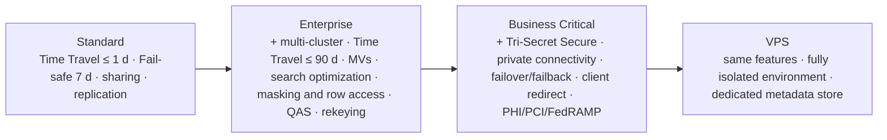

# Snowflake Editions

Four per-account tiers (Standard, Enterprise, Business Critical, VPS); each adds features and raises the price per credit without changing how many credits a warehouse burns.



## Numbers

| Feature | Standard | Enterprise | Business Critical | VPS |
|---------|----------|------------|-------------------|-----|
| Time Travel max | 1 day | 90 days | 90 days | 90 days |
| Fail-safe | 7 days | 7 days | 7 days | 7 days |
| [[Multi-cluster Warehouse]] | — | ✓ | ✓ | ✓ |
| Materialized views, search optimization, query acceleration | — | ✓ | ✓ | ✓ |
| Masking, row access, aggregation and projection policies; `ACCESS_HISTORY` | — | ✓ | ✓ | ✓ |
| Periodic rekeying | — | ✓ | ✓ | ✓ |
| Tri-Secret Secure, private connectivity, failover/failback, client redirect | — | — | ✓ | ✓ |
| PHI, PCI DSS, FedRAMP/ITAR support | — | — | ✓ | ✓ |
| Isolated environment, dedicated metadata store and compute pool | — | — | — | ✓ |

Source for every row: intro-editions. Read your edition: `SELECT edition FROM SNOWFLAKE.ORGANIZATION_USAGE.ACCOUNTS WHERE account_name = CURRENT_ACCOUNT_NAME();` (needs `ORGANIZATION_USAGE` access) or Snowsight → Admin » Accounts.

## How it works

- Edition is set per account at creation and can be raised; everything below is included.
- Credits burn identically on every edition; the rate sheet multiplies them by an edition-specific price ([[Credits and Billing]]).
- Day 1–3 exercises and the team skeleton assume Enterprise (multi-cluster, 90-day Time Travel, masking).
- Business Critical adds network and key isolation, not performance.

## Probe

```sql
SHOW PARAMETERS LIKE 'DATA_RETENTION_TIME_IN_DAYS' IN ACCOUNT;   -- max settable value reveals Standard (1) vs higher
ALTER WAREHOUSE WH_LEARN_XS SET MAX_CLUSTER_COUNT = 2;          -- errors on Standard edition
```

Snowsight → Admin » Accounts (needs `ORGADMIN`) shows the edition per account.

## Cost

Price per credit and per TB rises by edition → `ORGANIZATION_USAGE.RATE_SHEET_DAILY` (phase 1 capstone). Credits consumed → unchanged.

## Traps

- Fail-safe is 7 days on all editions; only Time Travel changes (1 vs 90).
- Multi-cluster, materialized views and masking start at Enterprise, not Business Critical.
- Business Critical was once named Enterprise for Sensitive Data (ESD).

**vs Cloudera:** per-node licence tiers for the whole cluster → a per-account tier you can raise with a support ticket, with price per credit as the lever. See [[Hadoop to Snowflake Rosetta Stone]].

## Related

- [[Multi-cluster Warehouse]]
- [[Credits and Billing]]
- [[Organizations and Accounts]]
- [[Database Storage Layer]]
- [[Snowflake Account]]

## Explain it to a teammate (fill in yourself)

>
