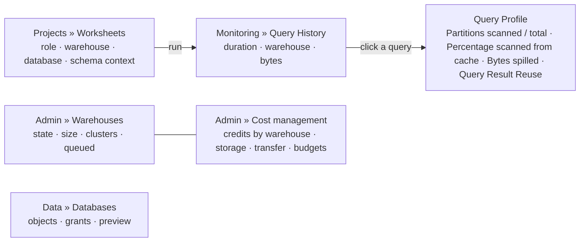

# Snowsight

The web UI: worksheets that send the same SQL a driver would, plus Query History, Query Profile, warehouse admin and Cost management.



## Numbers

| Where | Read this | Source |
|-------|-----------|--------|
| Projects » Worksheets | context bar: role, warehouse, database, schema | ui-snowsight |
| Monitoring » Query History | last 14 days; duration, warehouse, user, bytes scanned | [activity](https://docs.snowflake.com/en/user-guide/ui-snowsight-activity) |
| Query Profile » Pruning | `Partitions scanned`, `Partitions total` | activity |
| Query Profile » IO | `Percentage scanned from cache` | activity |
| Query Profile » Spilling | `Bytes spilled to local storage`, `Bytes spilled to remote storage` | activity |
| Query Profile » result reuse | single `Query Result Reuse` node | activity |
| Admin » Warehouses | state, size, started clusters, running and queued statements | ui-snowsight |
| Admin » Cost management | Account overview, Consumption (by warehouse, usage type), Budgets, Resource monitors | [cost-exploring](https://docs.snowflake.com/en/user-guide/cost-exploring-compute) |
| Admin » Accounts | organization view, needs `ORGADMIN` | ui-snowsight |

## How it works

- Worksheet → SQL → Cloud Services, identical to JDBC/ODBC/Python; nothing is UI-only.
- Query History → every statement in the account, filterable by warehouse and user; opens Query Profile.
- Query Profile → operator tree with the four numbers above: this is where pruning, caching and spilling claims are proved.
- Cost management → the same figures as `ACCOUNT_USAGE`, pre-adjustment for cloud services.

## Probe

Run the Day 1 lab query twice, then: Monitoring » Query History → run 1 → Query Profile → Pruning and IO sections; run 2 → `Query Result Reuse`. Admin » Warehouses → `WH_LEARN_XS` state flips to Suspended after `AUTO_SUSPEND`.

```sql
SELECT query_id, query_text, warehouse_name, total_elapsed_time
FROM TABLE(INFORMATION_SCHEMA.QUERY_HISTORY(RESULT_LIMIT => 10)) ORDER BY start_time DESC;  -- same list as the UI
```

## Cost

No direct cost; worksheet statements bill the worksheet's warehouse like any client.

## Traps

- The Create Warehouse form pre-selects X-Large.
- Query Profile, not elapsed time, is the evidence for pruning and cache claims.
- Classic console is gone; Snowsight is the only web UI.

**vs Cloudera:** Hue for SQL plus Cloudera Manager for the cluster → one UI, and anything it shows is reachable by SQL for scripting in phase 2. See [[Hadoop to Snowflake Rosetta Stone]].

## Related

- [[Query Pruning]]
- [[Result Cache]]
- [[Warehouse Cache]]
- [[Virtual Warehouse]]
- [[Credits and Billing]]

## Explain it to a teammate (fill in yourself)

>
