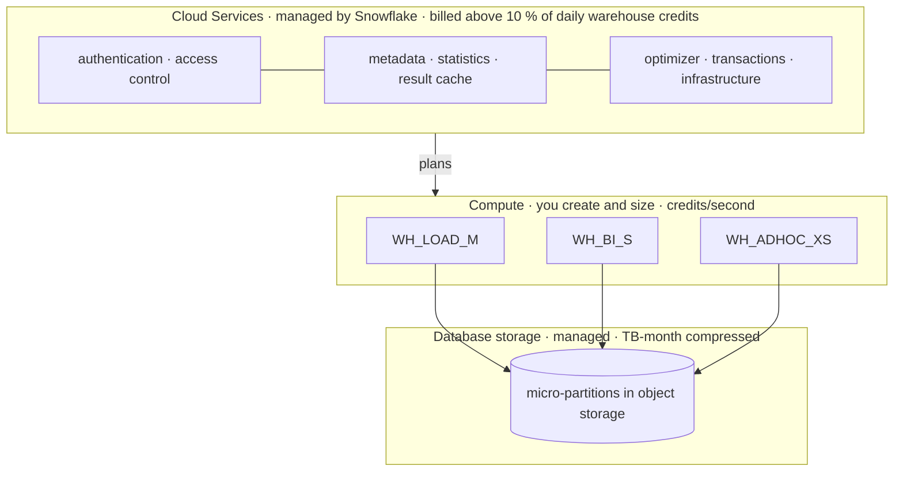

# Three-Layer Architecture

Storage, compute and Cloud Services as three independently scaled layers: shared-disk storage read by shared-nothing warehouse clusters, coordinated by a layer you never provision.



## Numbers

| Thing | Value | Source |
|-------|-------|--------|
| Layers you provision | 1 (compute) | intro-key-concepts |
| Layers billed | 3: credits, TB-month, Cloud Services excess over 10 % of daily warehouse credits | [cost overview](https://docs.snowflake.com/en/user-guide/cost-understanding-overall) |
| Docs name for the middle layer | "query processing" (compute); older material: "Query Processing layer" | intro-key-concepts |
| Architecture label | hybrid of shared-disk and shared-nothing | intro-key-concepts |

## How it works

- Shared-disk: one copy of every [[Micro-partitions|micro-partition]] in object storage, readable by every warehouse ([[Database Storage Layer]]).
- Shared-nothing: each [[Virtual Warehouse]] is an MPP cluster; nodes take a share of the pruned micro-partitions and exchange intermediates over the network ([[Compute Layer]]).
- [[Cloud Services Layer]] holds the metadata, so pruning and result reuse happen before any warehouse starts.
- Layers scale alone: more data → no compute change; more concurrency → more or bigger warehouses; no re-sharding.
- Isolation: warehouses never share compute, so `WH_LOAD_M` cannot slow `WH_BI_S`.

## Probe

```sql
SELECT COUNT(*) FROM SNOWFLAKE_SAMPLE_DATA.TPCH_SF1.LINEITEM;             -- Cloud Services only (metadata)
SELECT COUNT(*) FROM SNOWFLAKE_SAMPLE_DATA.TPCH_SF1.LINEITEM WHERE L_QUANTITY > 10;  -- needs a warehouse
```

Snowsight → Query History: the first shows no warehouse time; the second shows `WH_LEARN_XS` and, in Query Profile, `Partitions scanned` (Cloud Services pruning) and `Percentage scanned from cache` (warehouse SSD).

## Cost

Per layer → `WAREHOUSE_METERING_HISTORY.CREDITS_USED_COMPUTE` (compute), `STORAGE_USAGE.STORAGE_BYTES` (storage), `METERING_DAILY_HISTORY.CREDITS_ADJUSTMENT_CLOUD_SERVICES` (the 10 % rule). See [[Credits and Billing]].

## Traps

- "Query Processing" and "Compute" name the same layer.
- Only compute is yours to size; storage and Cloud Services have no knobs.
- Hybrid means both models at once, not a choice between them.

**vs Cloudera:** HDFS + YARN + Metastore on the same nodes, scaled together → three layers scaled and billed apart; no DataNodes to balance when compute changes. See [[Hadoop to Snowflake Rosetta Stone]].

## Related

- [[Database Storage Layer]]
- [[Compute Layer]]
- [[Cloud Services Layer]]
- [[What Snowflake Is]]
- [[Virtual Warehouse]]

## Explain it to a teammate (fill in yourself)

>
