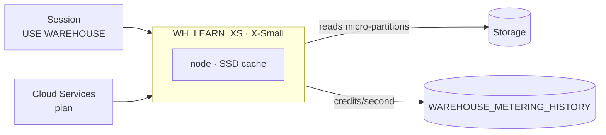
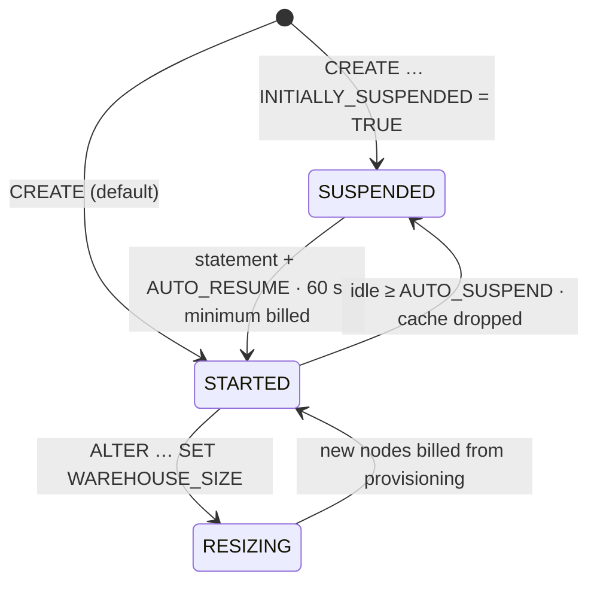

# Virtual Warehouse

A named cluster of compute nodes that executes statements and is billed in credits per second while started.





## Numbers

| Thing | Value | Source |
|-------|-------|--------|
| Default size, `CREATE WAREHOUSE` | X-Small | warehouses-overview |
| Default size, Snowsight form | X-Large pre-selected; the docs table now lists both sizes, so check before Create | warehouses-overview |
| `AUTO_SUSPEND` default | 600 s; `0` or `NULL` = never | [CREATE WAREHOUSE](https://docs.snowflake.com/en/sql-reference/sql/create-warehouse) |
| `AUTO_RESUME` default | `TRUE` | CREATE WAREHOUSE |
| `INITIALLY_SUSPENDED` default | `FALSE` | CREATE WAREHOUSE |
| Billing | per second, 60 s minimum per start | warehouses-overview |
| `SHOW WAREHOUSES` state | `STARTED`, `SUSPENDED`, `RESIZING` | [SHOW WAREHOUSES](https://docs.snowflake.com/en/sql-reference/sql/show-warehouses) |
| Types | `STANDARD`, `SNOWPARK-OPTIMIZED`, `ADAPTIVE`, `INTERACTIVE` | SHOW WAREHOUSES |
| Generation | `GENERATION = '2'` is the default where available; `generation` column in `SHOW WAREHOUSES`; the usual credit table is Gen1 | [CREATE WAREHOUSE](https://docs.snowflake.com/en/sql-reference/sql/create-warehouse), [gen2](https://docs.snowflake.com/en/user-guide/warehouses-gen2) |
| Current warehouse per session | 1 | warehouses-overview |

## How it works

- `CREATE WAREHOUSE` → object in Cloud Services, no nodes until `STARTED`.
- Statement needs compute → `AUTO_RESUME` → nodes provisioned (seconds) → 60 s billed even if the query takes 2 s.
- Plan arrives from [[Cloud Services Layer]] → nodes read only the pruned [[Micro-partitions]] → columns land in the node SSD ([[Warehouse Cache]]).
- Idle for `AUTO_SUSPEND` seconds → `SUSPENDED` → SSD cache gone, credits stop ([[Auto-suspend and Auto-resume]]).
- `ALTER … SET WAREHOUSE_SIZE` → running queries finish on old nodes, new and queued use the new size ([[Scaling Up vs Scaling Out]]).
- `MAX_CLUSTER_COUNT > 1` (Enterprise) → extra clusters of the same size for queueing ([[Multi-cluster Warehouse]]).
- One warehouse per workload: `WH_<TEAM>_<PURPOSE>_<SIZE>` (Day 3).

## Probe

```sql
SHOW WAREHOUSES LIKE 'WH_LEARN_XS';
-- columns: "state", "size", "auto_suspend", "auto_resume", "running", "queued", "generation"
ALTER WAREHOUSE WH_LEARN_XS SUSPEND;
SHOW WAREHOUSES LIKE 'WH_LEARN_XS';          -- state = SUSPENDED, no warehouse needed to run SHOW
SELECT 1;                                     -- no warehouse needed either
SELECT COUNT(*) FROM SNOWFLAKE_SAMPLE_DATA.TPCH_SF1.LINEITEM WHERE L_QUANTITY > 10;  -- resumes it
```

Snowsight → Admin » Warehouses → the same state, plus running and queued counts.

## Cost

Credits per second by size while `STARTED` → `ACCOUNT_USAGE.WAREHOUSE_METERING_HISTORY.CREDITS_USED_COMPUTE` (hourly rows). Idle share = `CREDITS_USED_COMPUTE − CREDITS_ATTRIBUTED_COMPUTE_QUERIES`. Sizes and the credit table: [[Warehouse Sizes and Credits]].

## Traps

- The Snowsight form pre-selects a size (X-Large in the docs table, which also lists X-Small); SQL defaults to X-Small. Read the size before Create.
- `SHOW`, `DESCRIBE`, result reuse and metadata-only aggregates run with the warehouse suspended.
- Dropping a warehouse drops no data; it holds only a cache.

**vs Cloudera:** a YARN queue with fixed executors → created, resized or suspended in seconds, per workload, holding no data, so nothing rebalances. See [[Hadoop to Snowflake Rosetta Stone]].

## Related

- [[Compute Layer]]
- [[Warehouse Sizes and Credits]]
- [[Auto-suspend and Auto-resume]]
- [[Scaling Up vs Scaling Out]]
- [[Multi-cluster Warehouse]]
- [[Warehouse Cache]]

## Explain it to a teammate (fill in yourself)

>
