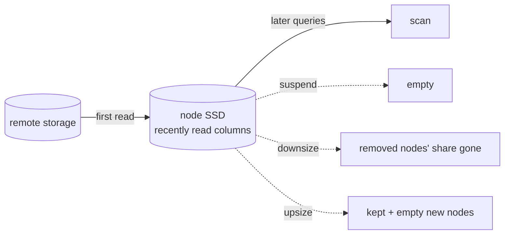

# Warehouse Cache

Local SSD on each warehouse node holding the columns of micro-partitions read by recent queries; it lives exactly as long as the warehouse stays started.



## Numbers

| Thing | Value | Source |
|-------|-------|--------|
| Lifetime | while the warehouse is started | warehouses-considerations |
| Dropped by | suspend (all); downsizing (removed nodes' portion) | warehouses-considerations |
| Scope | shared by every query on that warehouse; private to it | warehouses-considerations |
| Capacity | bounded by node SSD; grows with size | warehouses-considerations |
| Evidence | Query Profile IO → `Percentage scanned from cache`; `QUERY_HISTORY.PERCENTAGE_SCANNED_FROM_CACHE` (0.0–1.0) | [view](https://docs.snowflake.com/en/sql-reference/account-usage/query_history) |

## How it works

- Query → surviving [[Micro-partitions]] → referenced columns fetched from remote storage → written to node SSD on the way through.
- Next query touching the same columns → read from SSD → fewer seconds billed.
- Each node holds part of the cache; downsizing drops the removed nodes' portion, upsizing keeps what is there.
- Suspend → nodes released → cache empty → first query after resume pays full remote reads.
- Trade-off with [[Auto-suspend and Auto-resume]]: a BI warehouse suspended every 60 s re-reads its tables every refresh.

## Probe

```sql
ALTER SESSION SET USE_CACHED_RESULT = FALSE;
SELECT COUNT(*), SUM(L_QUANTITY) FROM SNOWFLAKE_SAMPLE_DATA.TPCH_SF1.LINEITEM
WHERE L_SHIPDATE BETWEEN '1995-01-01' AND '1995-01-31';   -- twice
SELECT query_id, percentage_scanned_from_cache FROM SNOWFLAKE.ACCOUNT_USAGE.QUERY_HISTORY   -- ACCOUNTADMIN or SNOWFLAKE.USAGE_VIEWER
WHERE warehouse_name = 'WH_LEARN_XS' ORDER BY start_time DESC LIMIT 5;   -- ≤ 45 min later
```

Run 1: 0 %. Run 2: well above 0 % in Query Profile → IO.

## Cost

No direct meter. Shows up as fewer warehouse seconds per query; the counter-cost is the idle time you pay to keep the cache warm (`CREDITS_USED_COMPUTE − CREDITS_ATTRIBUTED_COMPUTE_QUERIES`).

## Traps

- A resumed warehouse is a cold warehouse.
- Holds columns, not results; with result reuse on, run 2 never reaches it.
- Per warehouse: two warehouses on one table each warm their own SSD.

**vs Cloudera:** OS page cache on DataNodes, kept warm by a cluster that never stopped → explicit per-warehouse SSD wiped by suspend, so the idle timeout is a performance setting. See [[Hadoop to Snowflake Rosetta Stone]].

## Related

- [[Caching]]
- [[Virtual Warehouse]]
- [[Auto-suspend and Auto-resume]]
- [[Scaling Up vs Scaling Out]]
- [[Result Cache]]

## Explain it to a teammate (fill in yourself)

>
