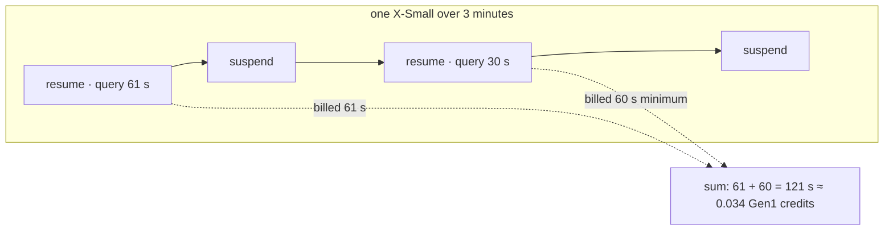

# Warehouse Sizes and Credits

Ten sizes, each doubling credits per hour; billed per second with a 60-second minimum whenever nodes are provisioned: start, resume, upsizing, an added cluster.



## Numbers

| Size | Credits/hour (Gen1) | Note |
|------|---------------------|------|
| X-Small | 1 | `CREATE WAREHOUSE` default |
| Small | 2 | |
| Medium | 4 | |
| Large | 8 | |
| X-Large | 16 | pre-selected in the Snowsight form (check before Create) |
| 2X-Large | 32 | |
| 3X-Large | 64 | |
| 4X-Large | 128 | |
| 5X-Large | 256 | AWS and Azure only; Gen1 only |
| 6X-Large | 512 | AWS and Azure only; Gen1 only |

Compute doubles with each size step; the docs publish credits per hour, not node counts.

| Rule | Value | Source |
|------|-------|--------|
| Granularity | per second after a 60 s minimum per start | warehouses-overview |
| Resize | new nodes billed when provisioned; running queries finish on old nodes | [considerations](https://docs.snowflake.com/en/user-guide/warehouses-considerations) |
| Multi-cluster | size credits × running clusters | [multi-cluster](https://docs.snowflake.com/en/user-guide/warehouses-multicluster) |
| Gen2 | default where available (`GENERATION = '2'`); higher rate per hour than the table above, published in the Service Consumption Table; read `generation` in `SHOW WAREHOUSES` | [gen2](https://docs.snowflake.com/en/user-guide/warehouses-gen2), [CREATE WAREHOUSE](https://docs.snowflake.com/en/sql-reference/sql/create-warehouse) |
| Price of a credit | by edition, cloud, region, contract; not in any `ACCOUNT_USAGE` view → `ORGANIZATION_USAGE.RATE_SHEET_DAILY` | [cost](https://docs.snowflake.com/en/user-guide/cost-understanding-overall) |

## How it works

- Size step → compute ×2 → credits/hour ×2 → a query that parallelises well runs ≈ 2× faster for the same credits.
- Gen2 warehouse → same size names, higher credits/hour; a new account creates Gen2 by default where the region supports it.
- A query that does not parallelise (single-partition scan, tiny result) → same seconds, double the credits.
- Resume → 60 s charged even for a 2 s statement; a bursty 5 s job every 90 s is mostly minimums.
- Spill to remote storage in Query Profile → size up one step and re-measure ([[Scaling Up vs Scaling Out]]).
- Queueing with short queries → clusters, not size ([[Multi-cluster Warehouse]]).

## Probe

```sql
SELECT start_time, warehouse_name, credits_used_compute, credits_used_cloud_services
FROM TABLE(INFORMATION_SCHEMA.WAREHOUSE_METERING_HISTORY(DATEADD('day', -1, CURRENT_TIMESTAMP())))
ORDER BY start_time DESC;     -- hourly rows, no latency, needs ACCOUNTADMIN or MONITOR USAGE
SHOW WAREHOUSES LIKE 'WH_LEARN_XS';   -- "generation": 1 or 2 decides which rate applies
ALTER WAREHOUSE WH_LEARN_XS SET WAREHOUSE_SIZE = SMALL;   -- then back to XSMALL
```

Snowsight → Admin » Cost management » Consumption → by warehouse.

## Cost

This is the compute meter: `WAREHOUSE_METERING_HISTORY.CREDITS_USED_COMPUTE` (hourly, ≤ 180 min latency, 365 days); per query `QUERY_ATTRIBUTION_HISTORY.CREDITS_ATTRIBUTED_COMPUTE`.

## Traps

- Doubling: XS 1, S 2, M 4, L 8, XL 16, 2XL 32, 3XL 64, 4XL 128, 5XL 256, 6XL 512.
- The 60 s minimum applies per resume, so a short `AUTO_SUSPEND` on a bursty workload can cost more than a longer one.
- Credits are the unit; the currency price is the rate sheet, not the docs.

**vs Cloudera:** node-hours of a cluster sized for peak and paid at idle → seconds × size, chosen per job and changed mid-day. See [[Hadoop to Snowflake Rosetta Stone]].

## Related

- [[Virtual Warehouse]]
- [[Auto-suspend and Auto-resume]]
- [[Scaling Up vs Scaling Out]]
- [[Multi-cluster Warehouse]]
- [[Credits and Billing]]

## Explain it to a teammate (fill in yourself)

>
