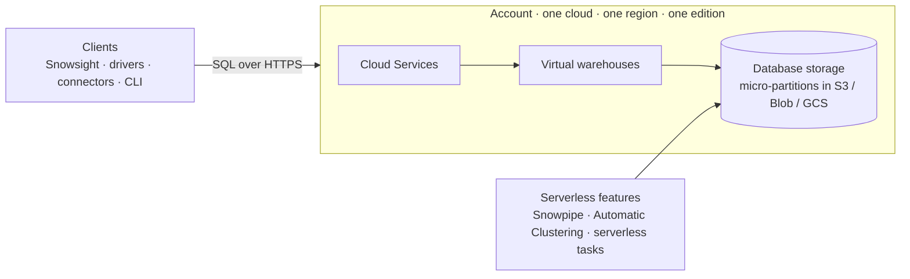

# What Snowflake Is

A SaaS data platform: one account in one cloud region, driven entirely through SQL, with storage, compute and a coordination layer that scale and bill separately.



## Numbers

| Thing | Value | Source |
|-------|-------|--------|
| Clouds | AWS, Azure, Google Cloud | intro-key-concepts |
| Delivery | SaaS; no install, no on-prem edition, no hardware to manage | intro-key-concepts |
| Layers | 3: storage, compute (query processing), Cloud Services | intro-key-concepts |
| Serverless features (Snowflake-managed compute, billed in credits) | Snowpipe, Automatic Clustering, serverless tasks, search optimization, materialized view maintenance | [metering](https://docs.snowflake.com/en/sql-reference/account-usage/metering_daily_history) `SERVICE_TYPE` |
| Engine | Snowflake's own storage format and SQL engine; not Hadoop, Spark or Postgres | intro-key-concepts |

## How it works

- Client → HTTPS → [[Cloud Services Layer]]: authenticate, parse, optimise, prune.
- Plan → a [[Virtual Warehouse]] you own → reads [[Micro-partitions]] from the [[Database Storage Layer]].
- Storage grows without touching compute; compute is added per workload without touching storage ([[Three-Layer Architecture]]).
- Serverless features run on Snowflake-managed compute: no warehouse of yours, still credits.
- Account scope: one [[Snowflake Editions|edition]], one [[Cloud Providers and Regions|cloud and region]], inside one [[Organizations and Accounts|organization]].

## Probe

```sql
SELECT CURRENT_REGION(), CURRENT_ORGANIZATION_NAME(), CURRENT_ACCOUNT_NAME(), CURRENT_VERSION();
```

Runs without a warehouse. `CURRENT_REGION()` returns e.g. `AWS_EU_CENTRAL_1`.

## Cost

No direct cost. Three meters: warehouse credits, storage TB-month, data transfer → [[Credits and Billing]].

## Traps

- No local or on-prem Snowflake; emulators (fakesnow, LocalStack) are not Snowflake.
- "Serverless" means Snowflake-managed compute that still bills credits, not "free".
- Nothing here runs on Hadoop or Spark; Spark can connect to it as a client.

**vs Cloudera:** the whole stack (HDFS, YARN, Hive, Impala, Spark, Ranger, CM) → one account you do not operate; your job starts at SQL and stops at SQL. See [[Hadoop to Snowflake Rosetta Stone]].

## Related

- [[Three-Layer Architecture]]
- [[Cloud Services Layer]]
- [[Compute Layer]]
- [[Database Storage Layer]]
- [[Credits and Billing]]

## Explain it to a teammate (fill in yourself)

>
