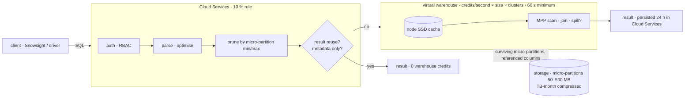

# Day 1 - The big picture

By the end: trace a query through the three layers, size and schedule a warehouse, read Query Profile, and name where today's credits are recorded.

**Rhythm (about 3 hours):** notes in order (60 to 90 min) → hands-on in Snowsight (45 min) → flashcards deck `day1` (15 min) → `docker compose run --rm quiz day1` (20 min) → "Explain it to a teammate" on five notes (10 min).

Before you start: [[Obsidian Setup]], [[Snowflake Account]], [[Quiz Runner]].

## One query, three layers



## Read in this order

**Architecture**

1. [[What Snowflake Is]] — SaaS, one account per cloud region, serverless = Snowflake-managed compute still billed.
2. [[Three-Layer Architecture]] — shared-disk storage, shared-nothing warehouses; only compute has knobs.
3. [[Cloud Services Layer]] — auth, metadata, optimizer, result reuse; billed only above 10 % of daily warehouse credits.
4. [[Compute Layer]] — isolated MPP clusters; spill to remote storage is the scale-up signal.
5. [[Database Storage Layer]] — compressed, encrypted micro-partitions; billed on average daily bytes incl. Time Travel and Fail-safe.

**Storage**

6. [[Micro-partitions]] — 50–500 MB uncompressed, load order, per-column min/max and distinct counts.
7. [[Query Pruning]] — metadata decides which micro-partitions are never read; `Partitions scanned / total` is the proof.
8. [[Clustering Keys]] — multi-TB tables only; Automatic Clustering is serverless and bills with no warehouse.

**Compute**

9. [[Virtual Warehouse]] — states `STARTED` / `SUSPENDED` / `RESIZING`; SQL default X-Small, the Snowsight form pre-selects larger: check before Create.
10. [[Warehouse Sizes and Credits]] — XS 1 → 6XL 512 credits/hour (Gen1), doubling; Gen2 is the default where available and costs more per hour; per second after 60 s.
11. [[Auto-suspend and Auto-resume]] — default 600 s, checked every ≈ 30 s, `0` never suspends; suspend drops the SSD cache.
12. [[Scaling Up vs Scaling Out]] — long `execution_time` or spills → up; long `queued_overload_time` → out.
13. [[Multi-cluster Warehouse]] — Enterprise+; Standard vs Economy policy; UI max 10 clusters, SQL up to 300.

**Caching**

14. [[Caching]] — result reuse → metadata → warehouse SSD, in that order.
15. [[Result Cache]] — byte-identical text, unchanged data, 24 h reset on reuse, 31 days max.
16. [[Warehouse Cache]] — node SSD, gone on suspend, partly gone on downsize.
17. [[Metadata Cache]] — whole-table `COUNT` / `MIN` / `MAX` and `SHOW` without a warehouse.

**Platform**

18. [[Snowflake Editions]] — Standard 1-day Time Travel; Enterprise adds multi-cluster, 90 days, masking; Business Critical adds keys and network.
19. [[Cloud Providers and Regions]] — one cloud and region per account; egress is the transfer meter.
20. [[Organizations and Accounts]] — `ORGADMIN` ≠ `ACCOUNTADMIN`; currency figures live in `ORGANIZATION_USAGE`.
21. [[Snowsight]] — Query History → Query Profile: the four numbers to read.
22. [[Credits and Billing]] — three meters; only `METERING_DAILY_HISTORY.CREDITS_BILLED` is what you pay. The full metrics and price read-out is the last stop of [[Day 3]].

## Hadoop bridge

| Cloudera | Snowflake | What changes |
|----------|-----------|--------------|
| HDFS + Parquet/ORC files | [[Database Storage Layer]], [[Micro-partitions]] | no files, no directories, no direct reads |
| YARN queues, Spark executors | [[Virtual Warehouse]] | per-workload clusters, seconds to create, hold no data |
| Hive Metastore, Ranger, ResourceManager | [[Cloud Services Layer]] | also holds per-micro-partition stats and persisted results |
| Hive partitions and buckets | [[Query Pruning]], [[Clustering Keys]] | every column prunes; clustering only for multi-TB tables |
| Hive/Impala planner | optimizer in Cloud Services | prunes from metadata before compute starts |

Full table: [[Hadoop to Snowflake Rosetta Stone]].

## Hands-on in Snowsight

> [!warning] Not yet executed by the author
> These steps follow the docs but were written without an account to run them on. If a menu name or result differs, note it; it goes into the next revision.

1. **Account and warehouse.** Complete [[Snowflake Account]]: a login and a warehouse `WH_LEARN_XS` (X-Small, auto-suspend 60 s).
2. **Tour.** In [[Snowsight]] find: Projects → Worksheets; Monitoring → Query History; Admin → Warehouses; Admin → Cost Management. Open a worksheet, role `SYSADMIN` (owner of `WH_LEARN_XS`), warehouse `WH_LEARN_XS`. `ACCOUNTADMIN` is needed only in step 8.
3. **Result cache.** Run this twice:
   ```sql
   SELECT COUNT(*), SUM(L_QUANTITY)
   FROM SNOWFLAKE_SAMPLE_DATA.TPCH_SF1.LINEITEM
   WHERE L_SHIPDATE BETWEEN '1995-01-01' AND '1995-01-31';
   ```
   Query History → second run near-zero duration → Query Profile shows the single node **Query Result Reuse**. See [[Result Cache]].
4. **Pruning.** Query Profile of the *first* run → TableScan → **Partitions scanned** vs **Partitions total**. Rerun with `WHERE TO_CHAR(L_SHIPDATE,'YYYY-MM') = '1995-01'` and compare. See [[Query Pruning]].
5. **Metadata.** `ALTER WAREHOUSE WH_LEARN_XS SUSPEND;` then `SELECT COUNT(*) FROM SNOWFLAKE_SAMPLE_DATA.TPCH_SF1.LINEITEM;` → Admin → Warehouses still suspended. Add `WHERE L_QUANTITY > 10` → resumes. See [[Metadata Cache]].
6. **Warehouse cache.** `ALTER SESSION SET USE_CACHED_RESULT = FALSE;` run the step-3 query twice → second Query Profile → IO → **Percentage scanned from cache**. See [[Warehouse Cache]].
7. **Sizes.** `ALTER WAREHOUSE WH_LEARN_XS SET WAREHOUSE_SIZE = SMALL;` then back to `XSMALL`; nothing restarts. See [[Scaling Up vs Scaling Out]].
8. **Cost.** Admin → Cost Management → today's credits for `WH_LEARN_XS`; then
   ```sql
   SELECT warehouse_name, SUM(credits_used) AS credits
   FROM TABLE(INFORMATION_SCHEMA.WAREHOUSE_METERING_HISTORY(DATEADD('hour', -24, CURRENT_TIMESTAMP())))
   GROUP BY 1;
   ```
   Needs `ACCOUNTADMIN` or `MONITOR USAGE`; on a team account without either, read Cost Management only and ask for `GRANT MONITOR USAGE ON ACCOUNT TO ROLE <your role>`. An X-Small with 60 s auto-suspend keeps the session under a fraction of one credit. See [[Credits and Billing]].

## Drill

1. Spaced Repetition deck `flashcards/day1`, every card once (about 72 cards, 10 to 15 minutes).
2. `docker compose run --rm quiz day1` (or `python3 quiz/quiz.py day1`). Pass bar: 80 %.
3. Below 80 %: reread the notes under *Missed concepts*, then `quiz review` until they come back right, then `day1` again.
4. `quiz stats` shows the weakest concepts and which note to reread.
5. Two sentences in the "Explain it to a teammate" box of at least five notes. Pick the shakiest.

## Acceptance

Tick these off, then tick "Day 1" on [[00 Home]]:

- [ ] The vault opens in Obsidian and the graph shows seven colour groups.
- [ ] The Spaced Repetition deck `day1` lists about 72 cards.
- [ ] `quiz day1` runs end to end and shows a score.
- [ ] `checks/run.sh` (or `docker compose run --rm checks`) ends with "all checks passed".
- [ ] The hands-on steps worked (step 8: ran the query, or asked for the grant), or you noted which step differed from the description.
- [ ] Quiz score of 80 % or better.

Next: [[Day 2]].
