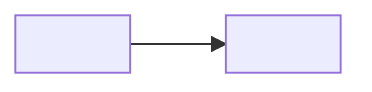

# {{title}}

<One sentence. Precise, no adjectives.>



## Numbers

| Thing | Value | Source |
|-------|-------|--------|
| <default, limit or unit> | <value> | <doc page> |

## How it works

- <mechanism, A → B → C; at most 8 bullets, no motivation>

## Probe

```sql
-- what to run
```

Where to look (Snowsight path or view) → what you should see.

## Cost

How it is metered → `VIEW.COLUMN`. Or: No direct cost; see [[Credits and Billing]].

## Traps

- <at most 3>


## Related

- [[<note>]]
- [[<note>]]
- [[<note>]]

## Explain it to a teammate (fill in yourself)

>
